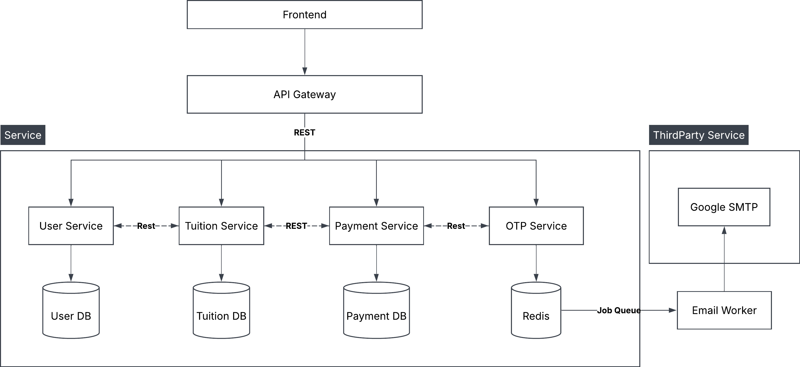
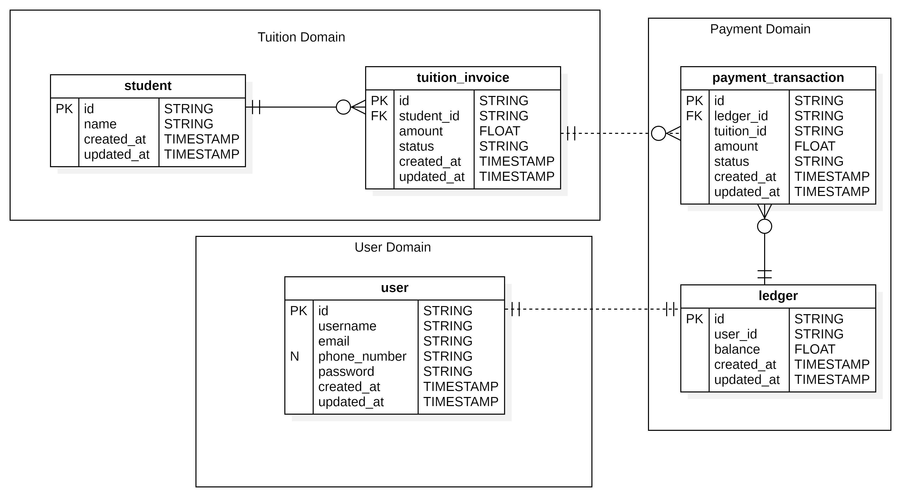
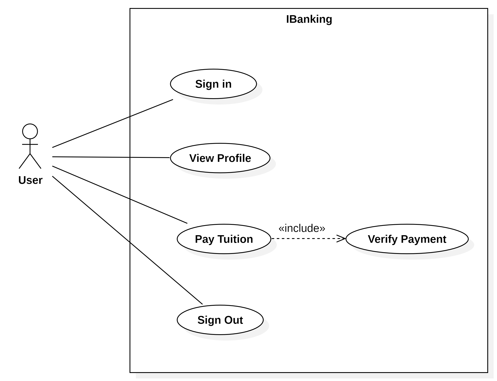

# Architecture

This document is about the **Architecture** of the project.

---

## Microservice Architecture Diagram

The system is built using a **Microservices Architecture**. The diagram below illustrates the high-level architecture and interaction between components:

---

## Services

The project is divided into four core business services:

| ID | Service Name | Description |
| :-- | :-- | :-- |
| S-01 | User Service | Manages user accounts and profile information (e.g., name, username, email). |
| S-02 | Tuition Service | Manages student information and tuition records. |
| S-03 | Payment Service | Processes payment transactions and ensures financial data integrity. |
| S-04 | OTP Service | Handles OTP generation, verification, and email notifications. |

> [!Note]: Some closely related domains have been merged into a single service. For instance, the Student Service and Tuition Service were combined into the Tuition Service due to their tight domain relationship and minimal data footprint (the `Student` entity only contains two attributes: `id` and `name`).

Inter-service communication is implemented over REST instead of gRPC for the following reasons:
- Simpler to set up, integrate, and maintain.
- Easier to inspect payloads, debug, and trace errors when issues occur.

---

## Entity Relationship Diagram

Diagram below is Entity Relationship diagram for IBanking application.

Each entity resides within its respective domain (e.g., User stays at User Domain), Dashed line represent soft (logical) references between them.

---

## Use Case Diagram

| ID | Name | Primary Actor | Description |
| :-- | :-- | :-- | :-- |
| UC-01 | Sign In | User | Authenticates user and supply JWT Token. |
| UC-02 | View Profile | User | Views user information, ledger balance and transaction history. |
| UC-03 | Lookup Student & Tuitions | User | Views student information via Student ID and unpaid tutions history. |
| UC-04 | Initiate Tuition Payment | User | Select a tuition to begin a transaction. System will check the balance and send OTP via email. |
| UC-05 | Verify Payment | User | Input 6 digits OTP from email to verify the transaction. |
| UC-06 | Sign out | User | Logout from current session |

---

