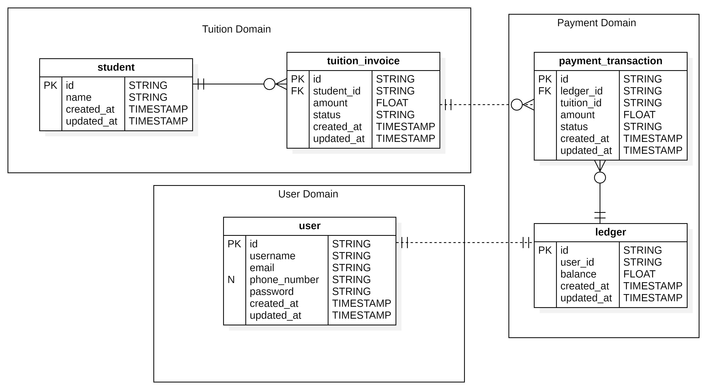

# Entity Relationship Diagram

This document is about the **Entity Relationship Diagram** of the project.

The project divided into 4 different business Domain/Service:

| ID | Service Name | Description |
| :-- | :-- | :-- |
| S-01 | User Service | The service is responsible for user information such as name, username, email, etc. |
| S-02 | Tuition Service | The service is responsible for student information and tuitions. We combine both student and tuition into a single service is because they are closely related to each other and the dataset is not big enough for a separate student service. |
| S-03 | Payment Service | The service is responsible for payment transaction only, its main responsibility is to keep the data integrity. |
| S-04 | OTP Service | The service is responsible for OTP generate and email sending. |

---

## ER Diagram

Diagram below is Entity Relationship diagram for IBanking application.

Each entity resides within its respective domain (e.g., User stays at User Domain), Dashed line represent soft (logical) references between them.
